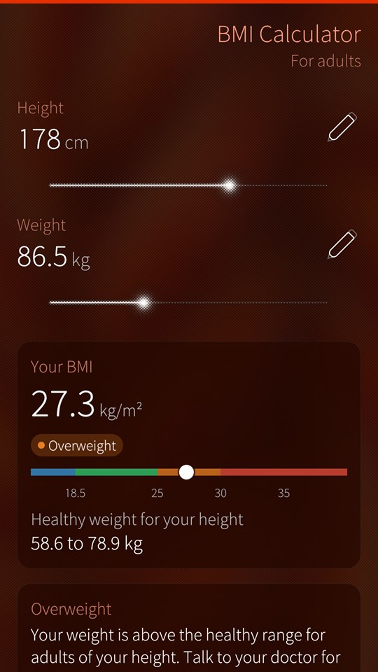
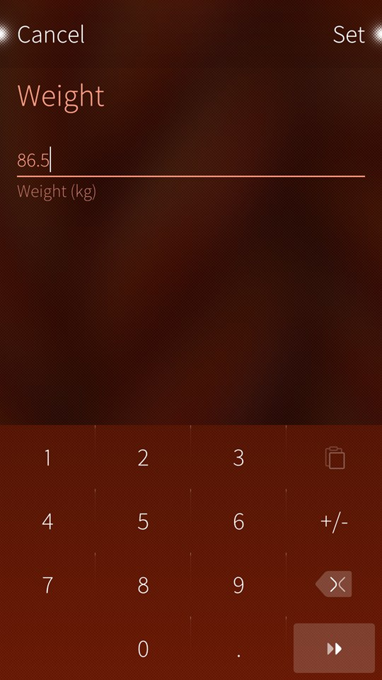
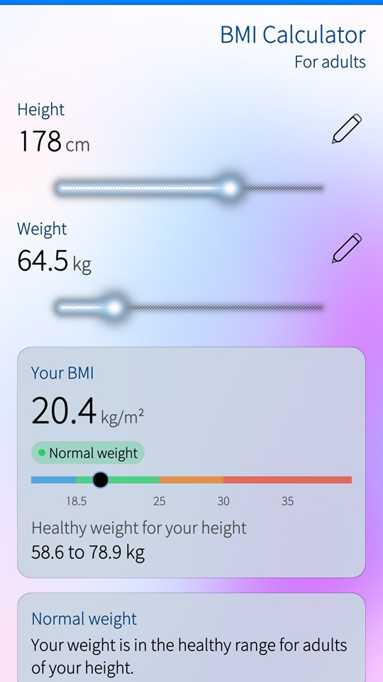

<p align="center">
  
</p>

<h1 align="center">Simple BMI Calculator for Sailfish OS</h1>

<p align="center">
  <b>Your body mass index, and what it means.</b><br>
  From your height and weight, with its category and the healthy weight range for your height.
</p>

<table>
  <tr>
    <td><a href="docs/images/bmi.jpg"></a></td>
    <td><a href="docs/images/bmi-type.jpg"></a></td>
    <td><a href="docs/images/bmi-light.jpg"></a></td>
  </tr>
</table>

## What you get

- **Sliders, or exact values.** Set your height and weight with the sliders, or tap a value to type it, from 50 to 250 cm and from 20 to 350 kg.
- **A clear result.** The BMI to one decimal, its category in colour, and where it falls on the scale from underweight to obesity.
- **Your healthy weight.** The range of weights that gives a healthy BMI at your height.
- **Cover support.** The BMI and its category without opening the app.

The categories are those of the World Health Organization and the CDC for adults. The BMI is a screening measure: it does not tell fat from muscle, and it is not medical advice.

It follows your ambience, light or dark.

## For developers

Build and validate with the Sailfish SDK (`sfdk tools list` shows your targets), or with the Sailfish IDE:

```
sfdk -c target=SailfishOS-5.1.0.11-aarch64 build
sfdk -c target=SailfishOS-5.1.0.11-aarch64 check
```

The package version comes from the latest git tag, so tag the release commit (for example `1.0`) before building it; the About page shows the same version. The build also refreshes the translation catalogues in `translations/`, where new languages are welcome.

## Author

Adel Noureddine (© 2019-2026).

## License

Simple BMI Calculator is licensed under the GNU GPL 3 license only (GPL-3.0-only).

Copyright (c) 2019-2026, Adel Noureddine.
All rights reserved. This program and the accompanying materials are made available under the terms of the GNU General Public License v3.0 only (GPL-3.0-only) which accompanies this distribution, and is available at: https://www.gnu.org/licenses/gpl-3.0.en.html
